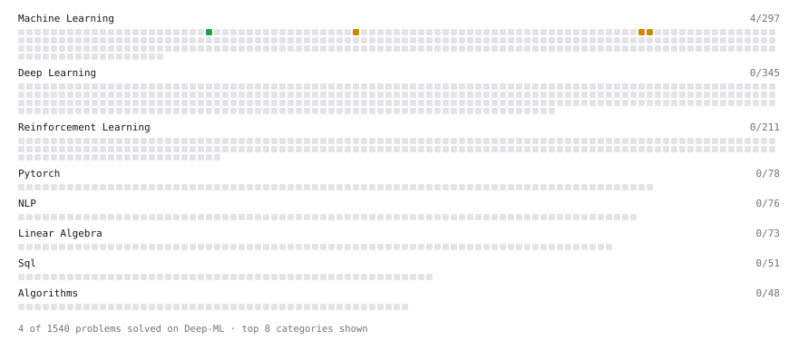

# Deep-ML

My machine learning practice from [Deep-ML](https://www.deep-ml.com). Every solution here was written by hand.

**8** solved · 5 problems · 0 labs · 3 math

[**Browse the interactive portfolio**](https://AlanPythonProgramming.github.io/deep-ml/) to replay this filling in over time.

## Problems

| | Difficulty | Solved | |
| --- | --- | --- | --- |
| [Implement Gini Impurity Calculation for a Set of Classes](https://www.deep-ml.com/problems/64) | easy | 2026-10-13 | [solution](problems/0064-implement-gini-impurity-calculation-for-a-set-of-classes) |
| [Decision Tree Pruning with Cost-Complexity](https://www.deep-ml.com/problems/285) | medium | 2026-10-14 | [solution](problems/0285-decision-tree-pruning-with-cost-complexity) |
| [Find the Best Gini-Based Split for a Binary Decision Tree](https://www.deep-ml.com/problems/138) | medium | 2026-10-13 | [solution](problems/0138-find-the-best-gini-based-split-for-a-binary-decision-tree) |
| [Implement Decision Tree for Regression](https://www.deep-ml.com/problems/286) | medium | 2026-10-13 | [solution](problems/0286-implement-decision-tree-for-regression) |
| [Implement Random Forest Feature Importance](https://www.deep-ml.com/problems/343) | medium | 2026-10-15 | [solution](problems/0343-implement-random-forest-feature-importance) |

## Math

| | Difficulty | Solved | |
| --- | --- | --- | --- |
| [Classification Trees: Gini, Entropy and Information Gain](https://www.deep-ml.com/math-problems/113) | medium | 2026-10-12 | [solution](math/0113-classification-trees-gini-entropy-and-information-gain) |
| [Regression Trees and Recursive Binary Splitting](https://www.deep-ml.com/math-problems/112) | medium | 2026-10-12 | [solution](math/0112-regression-trees-and-recursive-binary-splitting) |
| [Bagging, Variance Reduction and Random Forests](https://www.deep-ml.com/math-problems/114) | hard | 2026-10-16 | [solution](math/0114-bagging-variance-reduction-and-random-forests) |

---

_This file is regenerated by Deep-ML on every push._
